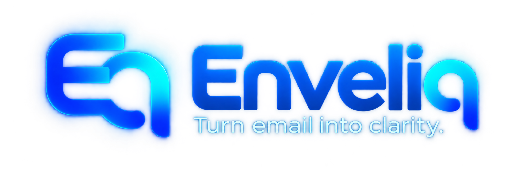
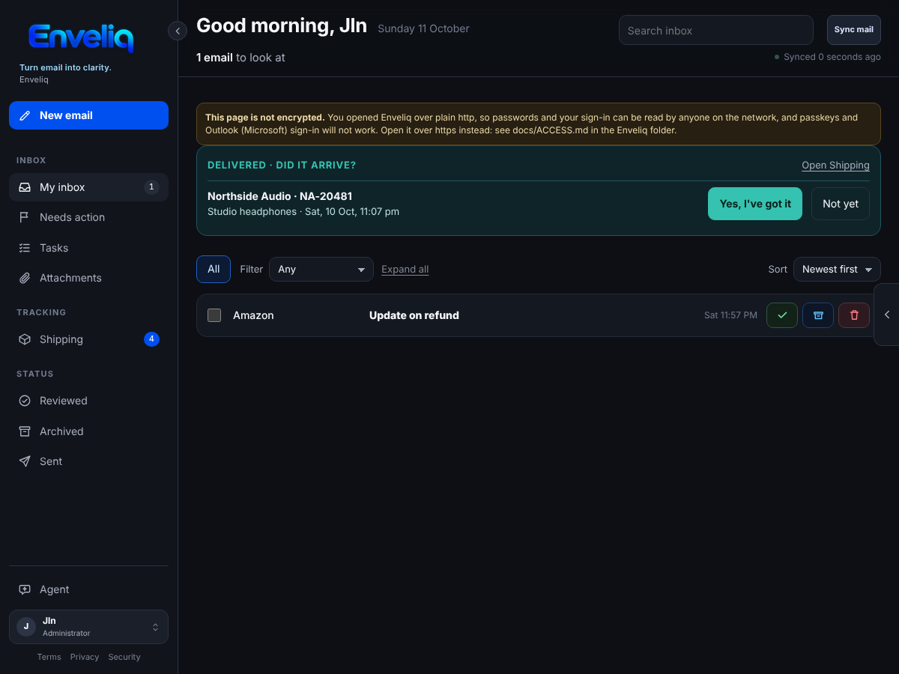
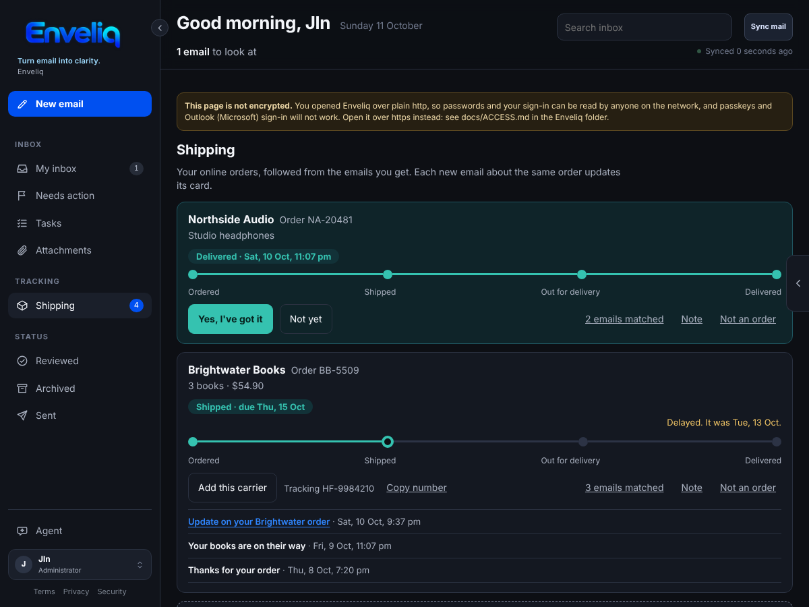
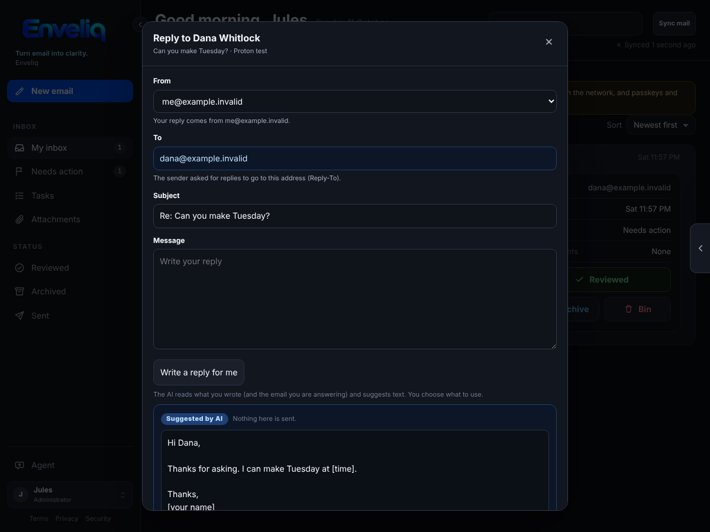

<p align="center">
  
</p>

<h3 align="center">Turn email into clarity.</h3>

<p align="center">
  A private email assistant that runs on your own computer.<br>
  It reads your inbox for you, tells you what needs a reply, and keeps everything else out of your way.
</p>

<p align="center">
  <a href="docs/install/README.md"><b>Install it</b></a> ·
  <a href="#what-you-get">What you get</a> ·
  <a href="#install">Install options</a> ·
  <a href="#questions">Questions</a> ·
  <a href="docs/README.md">All guides</a>
</p>

<p align="center"></p>

---

## Why Enveliq?

Email piles up. Most of it does not matter, but a few messages do: the bill due on Friday, the school form, the parcel that has not arrived, the question someone is waiting for you to answer. Finding those few means opening every message.

Enveliq does that sorting for you, calmly and in plain words, and **it does it on your own computer, not in somebody else's cloud.**

- **Know what needs you.** Each email gets a short summary and a clear label. Things that need action are pulled to the top. The rest can wait.
- **Nothing falls through the cracks.** Enveliq keeps a list of tasks it found in your email, parcels on their way, and emails where you are still waiting for an answer.
- **Calm by design.** Plain words, no clutter and big, clear buttons. It was designed to be easy on anyone who finds a full inbox stressful.
- **Private by design.** Your email is never copied into Enveliq. It stores only short, encrypted summaries, on your own machine. There is no account with us, no tracking and no ads. [How that works](#your-privacy)
- **For the whole household.** Everyone gets their own sign-in and their own private view. Nobody, administrators included, can read another person's mail.
- **You choose the AI.** Use a cloud AI service, or run one on your own network so that nothing leaves your home.

## What you get

| | |
|---|---|
| **Summaries** | A one or two line summary of every email, written by the AI you choose and always labelled as AI. |
| **Needs action** | Emails that want something from you float to the top. |
| **Tasks** | Things to do, found in your email, with due dates. You can send them to your calendar or to-do list. |
| **Shipping** | Your online orders followed from the emails you get, with a simple "Did it arrive?" |
| **Subscriptions** | Renewals and free trials followed from your email, with a reminder a few days before so a free trial never turns into a charge by surprise. |
| **Trips** | Flights, stays and hire cars followed from your booking emails, put together into trips, and added to your calendar if you like. |
| **Waiting for reply** | Reminds you of emails you sent that nobody has answered. |
| **Attachments** | Summaries of PDFs and other attachments, and a safe preview. The files themselves are never kept. |
| **Writing help** | Optional. The AI suggests a reply, or checks one you wrote. It only suggests: you decide what is sent. |
| **Reminders** | Gentle nudges by browser notification, email or Home Assistant. |
| **Messages** | A small private chat between the people in your household. |
| **Be careful flag** | A calm note on an email that looks like a scam, and a plain line saying whether your email provider could confirm who sent it, so you do not have to judge. |
| **Unsubscribe** | One button to leave a mailing list, when the sender allows it. |
| **Many mailboxes** | Gmail, Outlook and Microsoft 365, iCloud, Yahoo, Fastmail, Proton Mail (through Proton Bridge) and any other IMAP service. Replies work with alias services such as Proton Pass and SimpleLogin. |

<p align="center">
  
  
</p>

*The pictures use made-up example data.*

## Install

You do **not** need to know Linux or Docker. Every guide below tells you exactly what to click or type, one small step at a time. Plan on about 15 to 30 minutes.

**The short version** (Windows, Mac or Linux, with [Docker](https://www.docker.com/get-started/) installed):

1. Download [`install/docker-compose.yml`](install/docker-compose.yml).
2. Open it in any text editor and change the three lines marked `<-- CHANGE THIS` ([what to put](docs/install/choose-settings.md)).
3. Start it with `docker compose up -d`, then open **http://localhost:8765**.

**Pick the guide that matches what you have:**

| What you have | Guide |
|---|---|
| A Windows PC or a Mac | [**Docker Desktop**](docs/install/docker-desktop.md) (the easiest way to try it) |
| A Linux computer or server | [**Docker Compose on Linux**](docs/install/docker-compose.md) |
| A Raspberry Pi | [**Raspberry Pi and ARM**](docs/install/raspberry-pi.md) |
| A Proxmox server | [**Proxmox**](docs/install/proxmox.md) |
| Arcane | [**Arcane**](docs/install/arcane.md) |
| Portainer | [**Portainer**](docs/install/portainer.md) |
| Dockge | [**Dockge**](docs/install/dockge.md) |
| A Synology NAS | [**Synology**](docs/install/synology.md) |
| Unraid | [**Unraid**](docs/install/unraid.md) |
| TrueNAS SCALE | [**TrueNAS**](docs/install/truenas.md) |

Not sure? Start at [**Install Enveliq**](docs/install/README.md), which also lists what you need. Something not working? See [**Troubleshooting**](docs/install/troubleshooting.md).

## After you install

1. [**First-time setup**](docs/install/after-install.md): the one-time code, your administrator account and two-factor sign-in.
2. [**Connect your email**](docs/install/after-install.md#step-4-connect-your-email).
3. [**Turn on AI summaries**](docs/AI_SUMMARIES.md).
4. [**Open Enveliq on your phone**](docs/ACCESS.md) from anywhere, privately, with Tailscale or your own web address.
5. [**Add the other people in your home**](docs/install/after-install.md).
6. [**Update, back up and uninstall**](docs/install/maintenance.md).

## Your privacy

- **Raw emails and attachments are never stored.** Enveliq keeps only short summaries and structured results, encrypted.
- **Everything is locked in an encrypted vault** (AES-256-GCM, with the key protected by Argon2id) on your own machine.
- **One person's mail is never visible to another person**, and administrators run Enveliq without reading anyone's mail.
- **Email is treated as untrusted.** The AI is told that email text is only data, is given no tools, and never decides or calculates anything. Anything the AI wrote is labelled as AI.
- **Strong sign-in.** Passwords use Argon2id, with authenticator-app and passkey two-factor, recovery codes and single sign-on (Authentik, Authelia, Keycloak or any OpenID Connect service).
- **No telemetry, no third-party requests.** The pages load nothing from other websites, and the author receives no data. The one optional exception is a once-a-day check, made by your server (not your browser), for the number of the newest release, so administrators can be told when a new version is out. Nothing about you is sent, and an administrator can switch it off.

The full details are in [SECURITY.md](SECURITY.md) and the plain-language [privacy notes](docs/PRIVACY.md).

## Questions

<details>
<summary><b>Is it free?</b></summary>

Yes. Enveliq is free, open-source software under the [AGPL-3.0 licence](LICENSE). You may need to pay for an AI service if you choose a cloud one; running a model on your own network costs nothing.
</details>

<details>
<summary><b>Do I need an AI account?</b></summary>

Enveliq works best with an AI model to write the summaries. You can use a cloud service (OpenAI, Anthropic, Google Gemini and others) or a model on your own network. You can install first and add the AI later. See [AI summaries](docs/AI_SUMMARIES.md).
</details>

<details>
<summary><b>Can the AI see my email?</b></summary>

The AI you choose reads an email in order to write its summary. With a cloud AI service, that email text goes to that service, under its own privacy terms. If that matters to you, use a model running on your own network and nothing leaves your home. Enveliq itself keeps only the summary.
</details>

<details>
<summary><b>Can it send or delete my email?</b></summary>

It can send a reply, but only when you press Send. It never sends or deletes anything on its own, and the AI cannot do either. The one thing it does by itself is a [rule you set yourself](docs/MAIL_RULES.md), such as archiving new email from one sender, and a rule can never delete.
</details>

<details>
<summary><b>Do I have to open it to the internet?</b></summary>

No, and by default you should not. You can use it on one computer, on your home network, or privately from anywhere with a free [Tailscale](docs/ACCESS.md) account. Never forward a port on your router to Enveliq.
</details>

<details>
<summary><b>What if I forget my password or lose my phone?</b></summary>

Two-factor sign-in gives you ten one-time recovery codes. Keep them somewhere safe. See [First-time setup](docs/install/after-install.md) and [Troubleshooting](docs/install/troubleshooting.md).
</details>

<details>
<summary><b>Which computers does it run on?</b></summary>

Any computer that can run Docker: Windows, Mac, Linux, a NAS, a mini PC, a Proxmox server or a Raspberry Pi 4 or 5. The ready-made images are for ordinary 64-bit Intel or AMD computers; ARM computers build their own, which the [Raspberry Pi guide](docs/install/raspberry-pi.md) shows.
</details>

<details>
<summary><b>How do I get help, or report a problem?</b></summary>

Start with [Troubleshooting](docs/install/troubleshooting.md). If that does not solve it, open an issue on this page. Please do not paste real email, passwords or keys into an issue. To report a security problem, see [SECURITY.md](SECURITY.md).
</details>

## More guides

All the guides are listed, by what you want to do, in the [**documentation index**](docs/README.md). Some popular ones:
[Opening Enveliq from outside your home](docs/ACCESS.md) ·
[Single sign-on](docs/SSO.md) ·
[Outlook and Microsoft 365](docs/MICROSOFT.md) ·
[Proton Mail](docs/PROTON_BRIDGE.md) ·
[Calendar and to-do lists](docs/CALENDAR.md) ·
[Reminders](docs/NOTIFICATIONS.md) ·
[Writing help](docs/WRITING_HELP.md) ·
[The Be careful flag](docs/SCAM_WARNING.md) ·
[Snooze](docs/SNOOZE.md) ·
[Search](docs/SEARCH.md) ·
[Subscriptions](docs/SUBSCRIPTIONS.md) ·
[Trips](docs/TRIPS.md) ·
[Backup and restore](docs/BACKUP.md) ·
[New versions](docs/UPDATES.md) ·
[The demo](docs/DEMO.md) ·
[Undo](docs/UNDO.md) ·
[Checks before sending](docs/SEND_CHECKS.md) ·
[Important people](docs/IMPORTANT_PEOPLE.md) ·
[Signature and saved replies](docs/SAVED_REPLIES.md) ·
[Mail rules](docs/MAIL_RULES.md).

## Version history

<details>
<summary><b>What changed recently</b> (latest five versions)</summary>
- **Unreleased**: **A notice when a new version is out.** Administrators are told, with a card in the left panel linking to the release notes, when a newer version is out. Your server checks about once a day; nothing about you is sent, and an administrator can switch it off.

- **Unreleased**: **Undo bars stack.** Doing Reviewed, Archive or Bin on one email after another now shows one Undo bar for each (up to three), so you can still take back an earlier one. Several emails done together are still a single bar.
- **Unreleased**: **Mail rules.** Tell Enveliq to archive, or mark as reviewed, new email from a sender you choose, such as a shop's weekly offers. Press **Always archive these** on an opened email, or add a rule in Settings, Mail rules. A rule only acts on new email as it arrives, never on mail already in your inbox or from your important people, and no rule can delete anything. See [docs/MAIL_RULES.md](docs/MAIL_RULES.md).
- **Unreleased**: **"Keep me signed in on this device".** An administrator can let people stay signed in for up to 14 days with a tick-box on the sign-in page (off by default; needs a vault key file). Restarting Enveliq still signs everyone out.

- **Unreleased**: **No flash of sample data when you refresh.** Pressing refresh no longer shows the sample page (a sample name, counts and version) for a split second before your own page appears.
- **Unreleased**: **Shift + tick selects a range of emails.** Tick one email, hold Shift and tick another a few emails away, and every email between them is ticked too, up or down the list.
- **Unreleased**: **A quick check before a new email goes.** If a new email has no subject, or the words say something is attached but nothing is, Enveliq now asks once before sending. It never blocks you: **Send anyway** always sends. The check happens in the page, so it works the same for every mailbox. See [docs/SEND_CHECKS.md](docs/SEND_CHECKS.md).
- **Unreleased**: **Important people.** Pick the people whose email you never want buried, such as family, the school or your doctor. Their email is shown at the top of your inbox with a small **Important** label. Press **Important person** on an opened email, or manage the list in Settings, Important people. See [docs/IMPORTANT_PEOPLE.md](docs/IMPORTANT_PEOPLE.md).
- **Unreleased**: **Install Enveliq as an app, open the exact email from a notification, and optional new-email alerts.** Reminders by browser push already existed; this makes them useful on a phone.
- **Unreleased**: **A signature and saved replies.** Write your signature once and it is put at the bottom of every new email and reply when you open the box, where you can still change it. Keep short pieces of text you use often ("Running late", "Thank you") and insert one with a tap. Both are in Settings, Signature & saved replies. See [docs/SAVED_REPLIES.md](docs/SAVED_REPLIES.md).
- **v0.80**: **Five seconds to undo Reviewed, Archive and Bin, everywhere.** Pressing Reviewed, Archive or Bin now waits five seconds before it touches your mailbox, on every screen and for several ticked emails at once. The email leaves your list straight away and a bar at the bottom says what you did, with an **Undo** button. This used to be so only on a phone. See [docs/UNDO.md](docs/UNDO.md).
- **v0.79**: **The public status page says less.** Before anyone signs in, Enveliq's status page now says only what the sign-in, setup and unlock pages need. It no longer shows the version, the encryption settings or the public address, and it says whether Enveliq unlocks itself from a key file only while the vault is closed. Signed-in people see the version in the inbox; administrators see the technical detail. This came from a read-only security probe of the live site.
- **v0.78**: **Licence changed to AGPL-3.0.** Enveliq is now released under the GNU Affero General Public Licence, version 3, instead of MIT. Using, changing and sharing it stays free. The one new rule: if you change it and let other people use your version over a network, you share your changes under the same licence. The Terms of use page says so in plain words.
- **v0.77**: **Help links go to the Enveliq website.** The "Open the guide" links in Settings, Administration, the setup guide and the plain-http warning now open the guides on the Enveliq website (enveliq.app) instead of the project's GitHub pages, so they are easier to read and need no GitHub account.
- **v0.72**: **Search everywhere.** The search box now also tells you what it found in the other places Enveliq keeps things for you: emails in Reviewed, Archived and Snoozed, your tasks, the orders you are following and your waiting notes. A box called **Also found elsewhere** shows a few matches, each saying where it is, and pressing one takes you there. It uses only what Enveliq already keeps for you, so nothing new is saved. Also fixed: your tasks now show as soon as the page opens, not a minute later. See [docs/SEARCH.md](docs/SEARCH.md).

The full list is in [docs/VERSION_HISTORY.md](docs/VERSION_HISTORY.md), and a more technical one is in the [change log](docs/CHANGELOG.md).
</details>

Current version: **v0.81**

## For developers

<details>
<summary><b>Run without Docker, tests and repository layout</b></summary>

### Run without Docker

```bash
pip install -r requirements.txt
python run.py
```

It listens on `http://localhost:8765` and keeps its data in `data/`. Without `ENVELIQ_SETUP_CODE` the setup code is written to `data/setup-code.txt` (and the server log tells you where).

### Build the image yourself

```bash
cp .env.example .env            # set ENVELIQ_PUBLIC_URL to your address
docker compose up -d --build
docker compose exec enveliq cat /data/setup-code.txt
```

The repository's own `docker-compose.yml` builds from the source here. The ready-made install file for everyone else is [`install/docker-compose.yml`](install/docker-compose.yml). Architecture: [docs/ARCHITECTURE.md](docs/ARCHITECTURE.md).

### Tests

```bash
pip install -r requirements-dev.txt
pytest -q
```

Browser checks need Node.js and Playwright with Chromium (`npm install playwright && npx playwright install chromium`):

```bash
node scripts/check_prototype_injection.mjs   # hostile email content cannot run code in the inbox page
scripts/run_signin_e2e.sh                     # setup, authenticator app, passkeys, sign-in, admin pages
```

The full list of checks is in `.github/workflows/ci.yml`.

### Repository layout

| Path | What it is |
| --- | --- |
| `backend/` | Python/FastAPI server: encrypted vault, mailbox and message API, attachment preview store |
| `backend/auth/` | Accounts, passwords, TOTP, recovery codes, passkeys, OpenID Connect, sign-in API |
| `backend/mail/` | Mail fetching, AI summaries, tasks, shipping, writing help, reminders |
| `web/` | Sign-in, Settings and Administration pages (strict Content Security Policy) |
| `prototype/index.html` | The main inbox page |
| `install/` | Ready-made install files for everyone who is not building from source |
| `tests/` | Test suite (`pytest -q`) |
| `scripts/` | Browser checks and helper scripts |
| `docs/` | Guides: [index](docs/README.md) |
| `brand/` | Enveliq logo files |
| `Dockerfile`, `docker-compose.yml` | Container image and the source-building compose setup |
| `SECURITY.md`, `SECURITY_TEST_RESULTS.md` | Security model, review findings and latest test run |

</details>

## Licence

Enveliq is free, open-source software under the GNU Affero General Public Licence, version 3 ([LICENSE](LICENSE)). In plain words: use it, change it and share it freely, and if you change it and let other people use your version over a network, share your changes under the same licence. There is no telemetry and the author receives no data. Plain-language [terms of use](docs/TERMS.md) and [privacy notes](docs/PRIVACY.md) are also shown in the app, and are general summaries, not legal advice.
