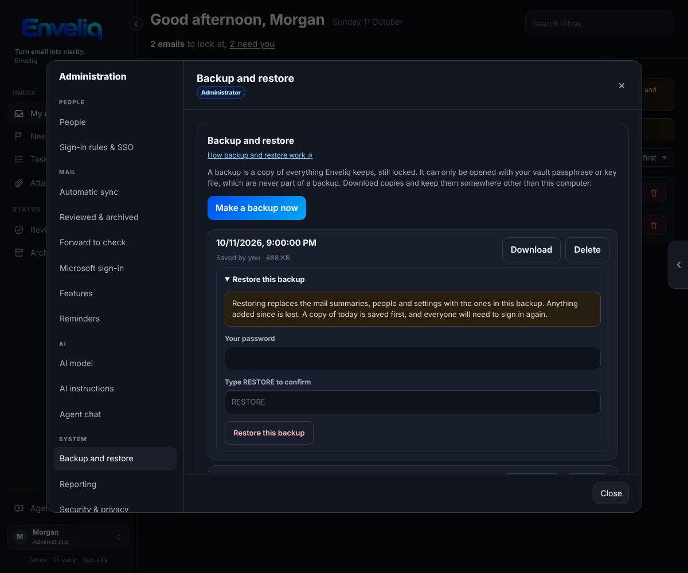
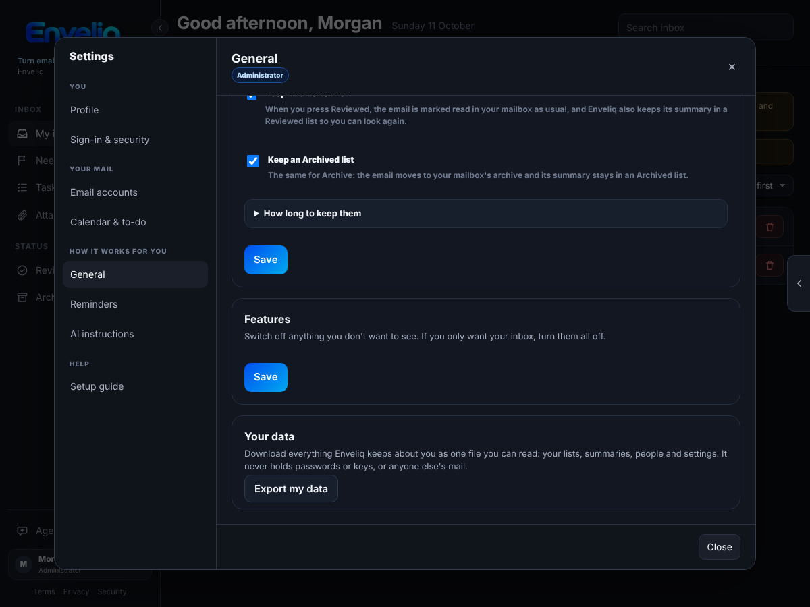

# Backup and restore, and Export my data

Two different things, for two different people:

- **Backup and restore** is for the administrator. It keeps a safe copy of everything Enveliq holds, so a broken disk or a mistake is not the end.
- **Export my data** is for everyone. It gives one person a file with their own information.

## Backup and restore (administrators)

Open **Administration, Backup and restore**.

**Make a backup now** saves a copy straight away. Each backup is one file in the `backups` folder next to the vault, inside your data folder. A backup is the vault exactly as it is stored: still locked. It holds no key. It cannot be opened without your vault passphrase or your key file, and the key file is never part of a backup (it lives somewhere else on purpose).

**Download** gives you the file to keep somewhere other than this computer. A copy that sits next to the vault on the same disk does not help if the disk fails.

### Daily backup

Switch on **Make a backup every day** and Enveliq saves one a day while the vault is unlocked. Daily copies older than the number of days you choose (1 to 60, default 7) are removed. Copies you made yourself, and the copy saved just before a restore, are never removed automatically. You can keep up to 20 copies you made yourself; delete one to make room.

### Restore

Open **Restore this backup** on the one you want. Restoring needs three things:

1. The vault is unlocked.
2. Your own password again. (If you sign in only with single sign-on, set a password in Settings first.)
3. The word **RESTORE** typed in.

It then replaces the mail summaries, mailboxes, people and settings with the ones in that backup. What happens around it:

- A copy of how things are today is saved first, as *Saved just before a restore*, so a restore can itself be undone.
- Everyone, you included, is signed out and signs in again.
- The record of who signed in and what was changed is kept, not replaced.
- Your vault passphrase does not change. Whatever passphrase works today still works.
- A backup made by a different Enveliq (a different key) is refused, and so is a backup that does not contain your own account, because restoring it would lock you out.

### Moving to a new computer

Restore here only works for backups from this same vault. To move, copy your vault key file (if you use one) and a backup to the new machine, put the backup in the data folder as `vault.sqlite3` while Enveliq is stopped, start Enveliq, and unlock it with the passphrase or key file that backup was made with.

## Export my data (everyone)

Open **Settings, General** and press **Export my data**. You get one readable file (JSON) with what Enveliq keeps about you: your profile and settings, the summaries kept from your own mailboxes, your tasks, orders, subscriptions, trips, things you are waiting for, the people in your address book, your assistant chats, and your messages with other people.

It never holds passwords, keys, tokens, two-factor or passkey secrets, your calendar link, or anyone else's mail. Enveliq does not keep email bodies or attachments, so those are not in it either. Nobody, administrators included, can export someone else's data.
