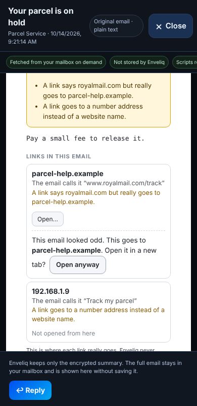
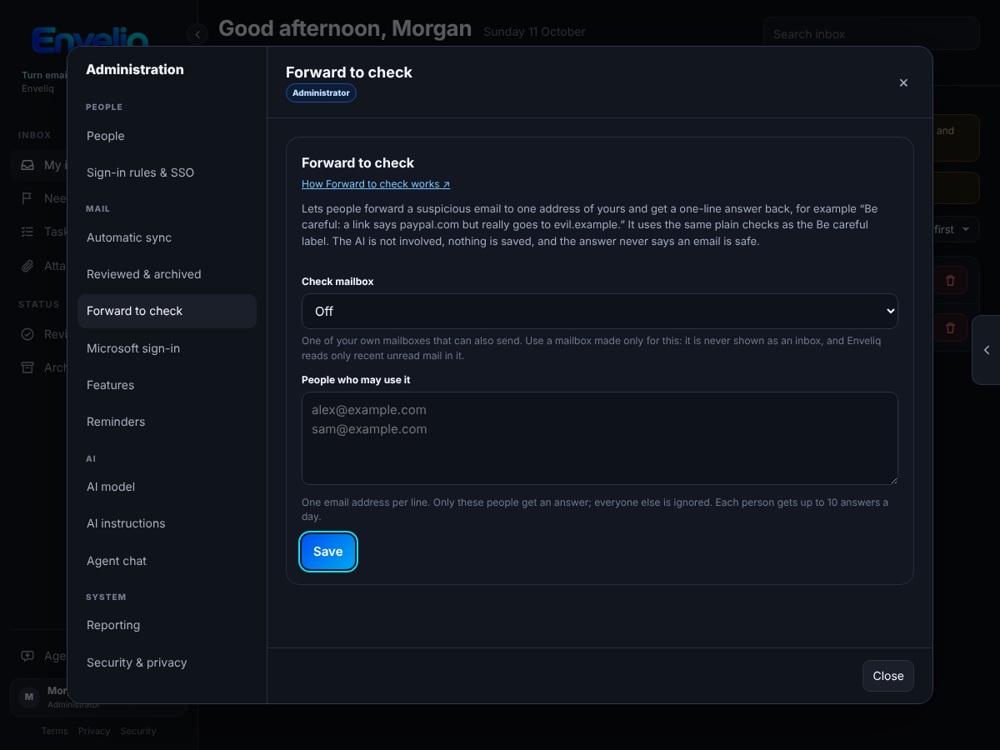
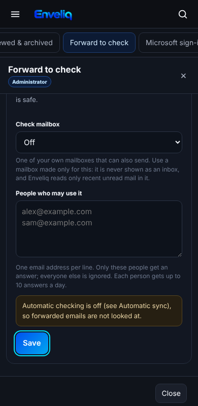

# The "Be careful" flag

Some emails are made to fool you: a fake delivery notice, a bank message with a link that goes somewhere else. Enveliq adds a small **Be careful** label to an email when something about it looks odd, and says what in plain words, so you do not have to judge it yourself.

It is **on for everyone and needs no setup**. It does not block, hide or delete anything.

## What people see

- A small **Be careful** label next to the subject in your list.
- A note on the email's card, and at the top of **View original email**, that says what looks odd, for example: *"A link says paypal.com but really goes to evil.example."*
- On a flagged email, **Unsubscribe** is not offered. Unsubscribing from a scam tells the sender your address is real, so one line says that instead of the button.

If you are unsure about an email with this label, the safest thing is to type the company's own website address yourself instead of using a link in the email.

On a phone the note stays short and the buttons keep their room:

*The pictures use made-up example data.*

## Is this really from them?

In **View original email**, a **Sender** line says whether your own email provider could confirm that the email really came from that address:

- *"Your email provider confirmed this came from that address."* (green)
- *"Your email provider could not confirm this came from that address."* (amber). This also adds a line to the Be careful note.
- Nothing at all when your provider gave no answer. Some providers add none.

If an email asks you to reply to a different website from the one it came from, the **Reply-To** line says so. When an email from a well-known name does this, it also gets the Be careful note.

On a phone the lines wrap and nothing runs off the screen:

The answer comes from the result your own provider writes into the email when it arrives (the SPF, DKIM and DMARC checks). Enveliq only reads it. It reads the provider's own line, never one the sender wrote. **Confirmed does not mean safe**: a scammer can use a real address of their own.

## What it looks for

- A link that names a well-known website but really goes to another one.
- A link that goes to a number (such as `203.0.113.9`) instead of a website name.
- A link to a website that copies a well-known name, such as `paypa1` or `dhl-parcel`, or one written with unusual letters that pass for ordinary ones.
- A sender whose name says one thing and whose address says another, such as "PayPal" writing from an unrelated address.
- A sender your own email provider could not confirm (it reports a failed DMARC check, or failed SPF and DKIM checks).
- An email from a well-known name that asks for replies at another website.

All of this is plain code that compares what an email says with what it does. **The AI is not asked and never decides.**

## What it does not do

- It does not say an email *is* a scam. It says what looks odd.
- It does not judge links that name some other website, because newsletters use tracking links all the time and a flag that cries wolf teaches people to ignore it.
- It only knows a short list of well-known names (for example PayPal, Amazon, Apple, Microsoft, Google, Netflix and common parcel carriers). An email pretending to be a name that is not on the list is not flagged.
- It does not read the text of an email for requests like "send me gift cards".

So **no label does not mean safe**. It is a helper, not a guarantee.

## Privacy

- Only website names (such as `evil.example`) and a fixed sentence are kept, inside the encrypted vault, and at most four per email. A whole link is never kept, because it can carry a private token. The email's text is never kept.
- Enveliq never opens or follows a link in an email.
- Link checks happen when an email is already being read for its summary, or when you press **View original email**. Nothing extra is fetched.

## For developers

- `backend/mail/scamcheck.py`: the checks and the short `BRANDS` list (add a name only together with its real domains).
- Header checks run at sync (`parse.summarise_headers`), link checks in `parse.render_original`; summarising merges them (`service._summarise_batch`).
- Tests: `tests/test_scamcheck.py`, `scripts/check_scam_warning.mjs`.

## Where does this link go?

In **View original email**, a **Links in this email** list shows each link in the email with the website it really goes to, what the email calls it, and a plain note when something looks odd, for example *"A link says royalmail.com but really goes to parcel-help.example."*

- **Nothing opens by itself.** Press **Open…** on a link and Enveliq says *"This goes to parcel-help.example. Open it in a new tab?"* Press **Open it** to go there.
- **On an email marked Be careful** the question is firmer. It says the email looked odd and the button reads **Open anyway**.
- **Some links cannot be opened from here**, such as a link to a number address or to a private address. They are listed with the reason and have no way to open.
- Only the website name is shown, not the rest of the address, because the rest can hold a personal token.
- **Web addresses in the text of the email can be clicked too.** An address in the text that is also in the list above (a plain public web address that did not look odd) is underlined. Clicking it does not open it: a bar at the top of the window says *"This goes to orders.example.com. Open it in a new tab?"* with **Open it** and **Not now**, the same question as the list. An address that was not checked, and every address in an email marked Be careful, stays plain text.

On a phone the list wraps and the buttons stay in reach:

Enveliq never opens a link for you and never fetches one. The list is worked out when you open the email and is not stored. It is plain code; the AI is not involved. A link that raises no note is not a promise that it is safe.

## Forward to check

Not sure about an email? Forward it to your household's check address and get one line back.

**Using it.** Forward the email *as an attachment* (in most mail apps: Forward, then choose **Forward as attachment**) to the check address. In a few minutes you get a reply with one line:

- *"Be careful:"* followed by what looks odd, for example *"A link says paypal.com but really goes to evil.example."*
- *"Nothing odd found. That does not prove it is safe."* A scammer can send a clean-looking email, so Enveliq never says an email is safe.

If you forward it as plain text instead of an attachment, Enveliq can only look at the links, and the answer says it could not see who sent it.

**Setting it up (administrators).** Make a new mailbox that is only for this and add it to Enveliq as usual. Then open **Settings, Administration, Forward to check**, choose that mailbox and list the people who may use it, one email address per line, and press **Save**. Automatic checking (Administration, Automatic sync) must be on.

On a phone the form fits the screen:

**What keeps it harmless.**

- Only the people you list get an answer. Everyone else is ignored, so the address cannot be used to send mail at strangers. An email whose sender your provider says was forged is ignored too.
- It ignores mailing lists, bulk mail and other automatic replies, and each answer is marked automatic, so two robots cannot start a loop. Each person gets up to 10 answers a day.
- The forwarded email is read once and never saved. The AI is not involved: these are the same plain checks as the Be careful label.
- The check mailbox is never shown as an inbox, to you or to anyone else. Enveliq only reads recent unread mail in it.
