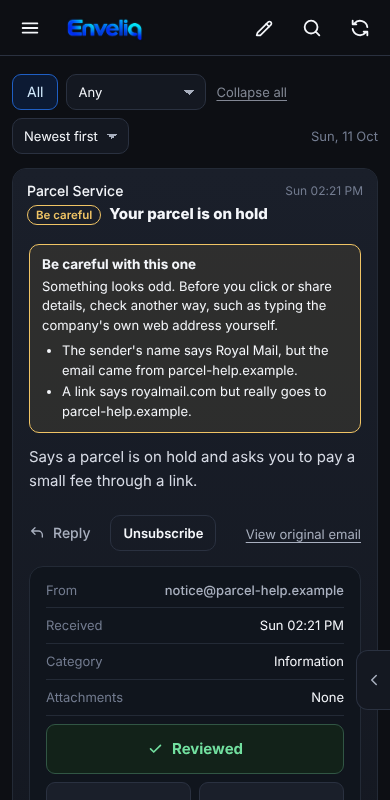
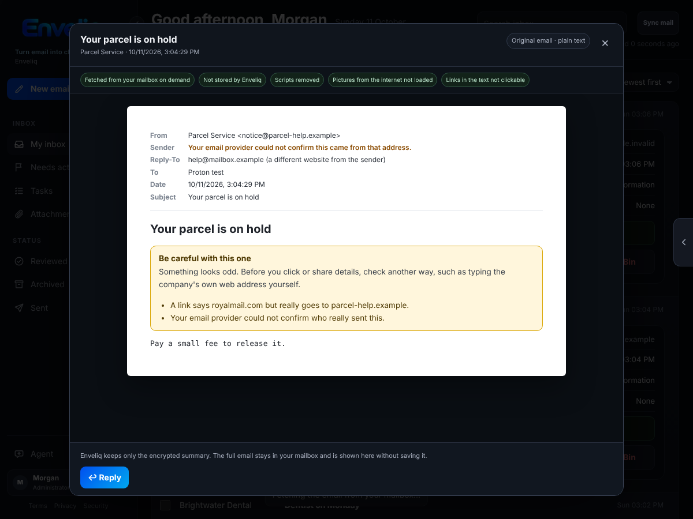
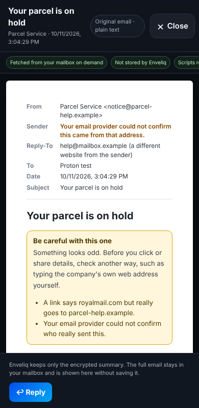

# The "Be careful" flag

Some emails are made to fool you: a fake delivery notice, a bank message with a link that goes somewhere else. Enveliq adds a small **Be careful** label to an email when something about it looks odd, and says what in plain words, so you do not have to judge it yourself.

It is **on for everyone and needs no setup**. It does not block, hide or delete anything.

## What people see

- A small **Be careful** label next to the subject in your list.
- A note on the email's card, and at the top of **View original email**, that says what looks odd, for example: *"A link says paypal.com but really goes to evil.example."*
- On a flagged email, **Unsubscribe** asks once more first. Unsubscribing from a scam tells the sender your address is real, so the button first says why, then offers **Go anyway**.

If you are unsure about an email with this label, the safest thing is to type the company's own website address yourself instead of using a link in the email.

On a phone the note stays short and the buttons keep their room:

*The pictures use made-up example data.*

## Is this really from them?

In **View original email**, a **Sender** line says whether your own email provider could confirm that the email really came from that address:

- *"Your email provider confirmed this came from that address."* (green)
- *"Your email provider could not confirm this came from that address."* (amber). This also adds a line to the Be careful note.
- Nothing at all when your provider gave no answer. Some providers add none.

If an email asks you to reply to a different website from the one it came from, the **Reply-To** line says so. When an email from a well-known name does this, it also gets the Be careful note.

On a phone the lines wrap and nothing runs off the screen:

The answer comes from the result your own provider writes into the email when it arrives (the SPF, DKIM and DMARC checks). Enveliq only reads it. It reads the provider's own line, never one the sender wrote. **Confirmed does not mean safe**: a scammer can use a real address of their own.

## What it looks for

- A link that names a well-known website but really goes to another one.
- A link that goes to a number (such as `203.0.113.9`) instead of a website name.
- A link to a website that copies a well-known name, such as `paypa1` or `dhl-parcel`, or one written with unusual letters that pass for ordinary ones.
- A sender whose name says one thing and whose address says another, such as "PayPal" writing from an unrelated address.
- A sender your own email provider could not confirm (it reports a failed DMARC check, or failed SPF and DKIM checks).
- An email from a well-known name that asks for replies at another website.

All of this is plain code that compares what an email says with what it does. **The AI is not asked and never decides.**

## What it does not do

- It does not say an email *is* a scam. It says what looks odd.
- It does not judge links that name some other website, because newsletters use tracking links all the time and a flag that cries wolf teaches people to ignore it.
- It only knows a short list of well-known names (for example PayPal, Amazon, Apple, Microsoft, Google, Netflix and common parcel carriers). An email pretending to be a name that is not on the list is not flagged.
- It does not read the text of an email for requests like "send me gift cards".

So **no label does not mean safe**. It is a helper, not a guarantee.

## Privacy

- Only website names (such as `evil.example`) and a fixed sentence are kept, inside the encrypted vault, and at most four per email. A whole link is never kept, because it can carry a private token. The email's text is never kept.
- Enveliq never opens or follows a link in an email.
- Link checks happen when an email is already being read for its summary, or when you press **View original email**. Nothing extra is fetched.

## For developers

- `backend/mail/scamcheck.py`: the checks and the short `BRANDS` list (add a name only together with its real domains).
- Header checks run at sync (`parse.summarise_headers`), link checks in `parse.render_original`; summarising merges them (`service._summarise_batch`).
- Tests: `tests/test_scamcheck.py`, `scripts/check_scam_warning.mjs`.
