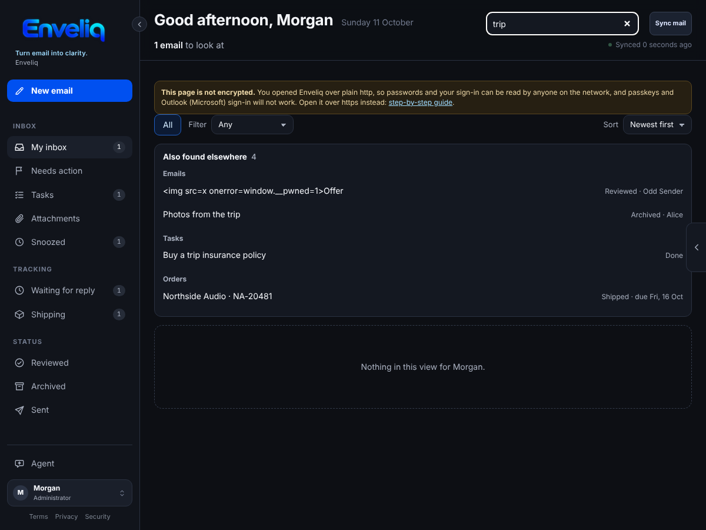
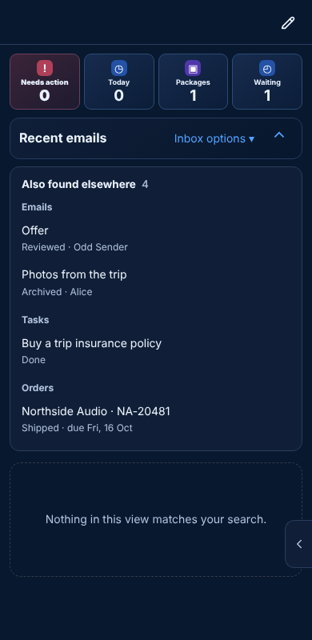

# Search

The **Search inbox** box at the top of Enveliq looks through the list you are on. Since v0.72 it also tells you what it found in the other places Enveliq keeps things for you.

It is on for everyone and needs no setup.

## What you see

Type at least two letters. Matches in your list appear as usual. If there are matches elsewhere, a box called **Also found elsewhere** appears above the list, grouped by where they are:

- **Emails** in Reviewed, Archived, Snoozed, or your inbox when you are looking at another list. Each says where it is, for example *Reviewed · Northside Power*.
- **Tasks**, with when each is due.
- **Orders** you are following.
- **Waiting for a reply**: emails you sent that are still waiting for an answer.

Press a match to go there. An email opens in the list it is in, ready to read. A task opens the email it came from. An order or a waiting note opens that page. The search box is cleared when you go.

On a phone the results are stacked so each one is easy to tap:

## What it searches

Only what Enveliq already keeps for you: the sender, subject and summary of each email card, task titles, order details and waiting notes. This box never looks inside your mailbox. Nothing new is saved by searching, and other people's emails, tasks and orders are never searched.

## Search all my mail

If the email you want is not in Enveliq's lists, the box also offers **Search all my mail**. That asks your mail service to search every folder of your mailbox. See [Find any email](FIND_MAIL.md).
