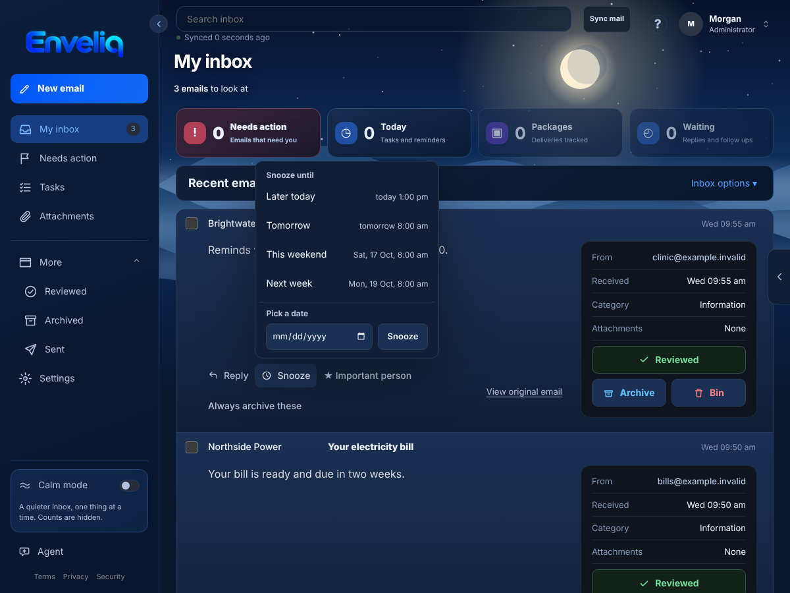
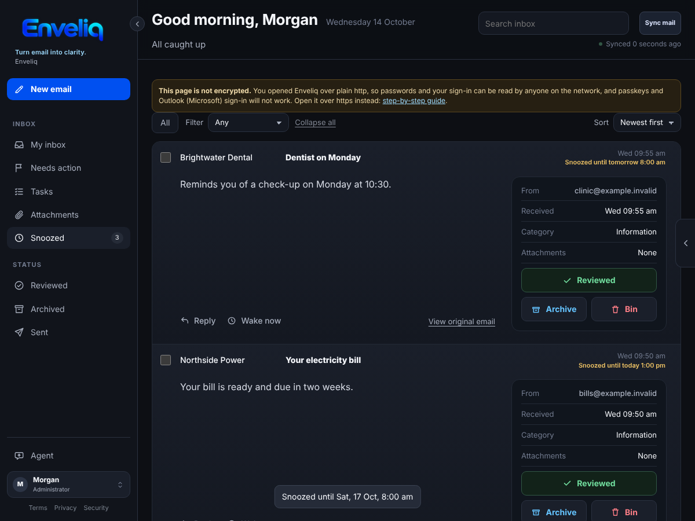
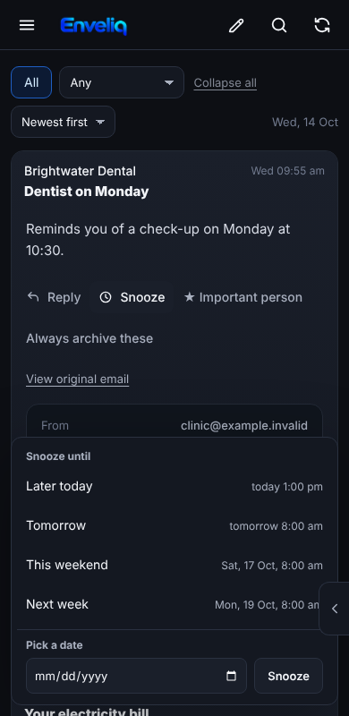

# Snooze

Some emails matter, just not right now. **Snooze** sets one aside and brings it back at the time you choose, so it does not sit in your inbox nagging you.

It is on for everyone and needs no setup.

## Using it

Open an email in your list and press **Snooze**. Choose when it should come back:

- **Later today**: three hours from now, to the next half hour (only offered while it is still today).
- **Tomorrow**: 8 am tomorrow.
- **This weekend**: Saturday at 8 am (offered on weekdays).
- **Next week**: Monday at 8 am.
- **Pick date and time**: any day and time you choose, from a minute ahead up to a year away. On Android the phone's own day and time pickers open. A time that has already passed is refused.

Each choice shows the day and time it means, in your own time zone, before you press it.

## Where it goes

A snoozed email leaves your inbox list. A **Snoozed** entry appears in the left menu with a count. Open it to see everything you have set aside and when each one comes back. **Wake now** puts one back straight away.

When the time comes, the email returns **at the top** of your inbox with a small *Back from snooze* note, and a short message tells you it is back. When nothing is snoozed, the Snoozed entry goes away.

On a phone the choices open as a panel at the bottom of the screen, with large buttons:

## Good to know

- Snoozing only changes Enveliq's list. Your real mailbox is left alone: the email stays unread there.
- Only Enveliq knows about the snooze. Other mail apps show the email as usual.
- Reviewing, archiving or deleting a snoozed email works as normal and ends the snooze.
- The time is worked out in your browser, in your own time zone, and sent as a single point in time. Enveliq stores only that time with the email's other encrypted details.
