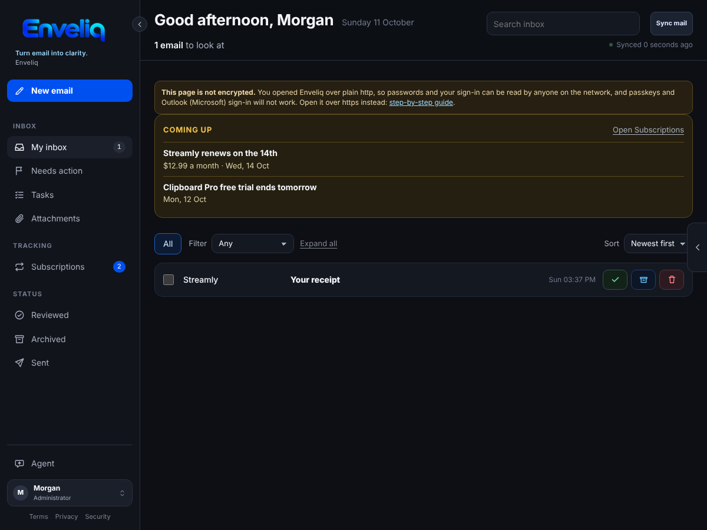
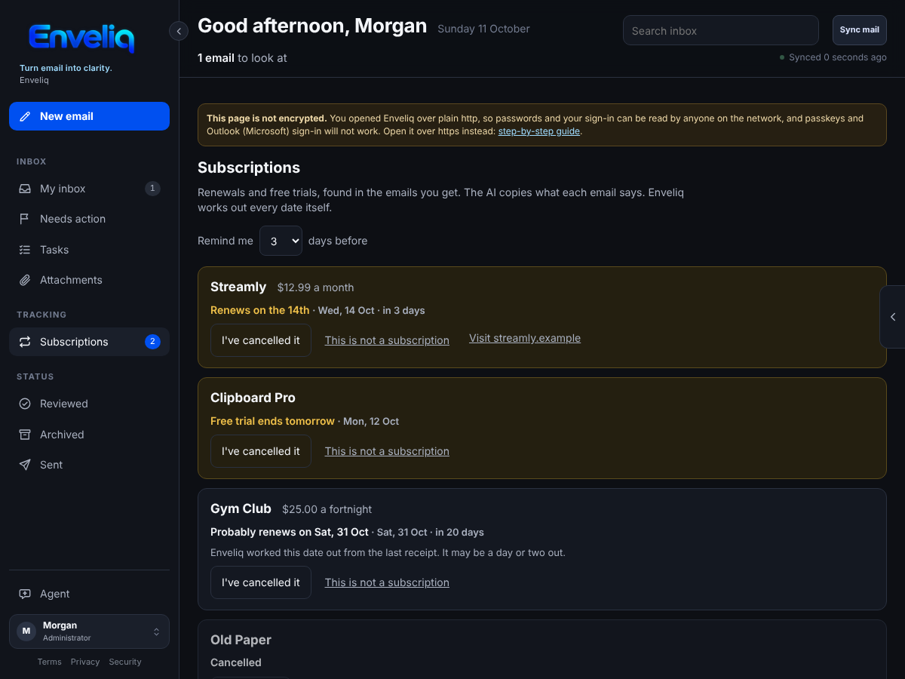
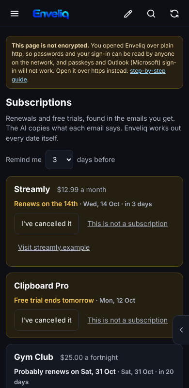

# Subscriptions and free trials

Enveliq follows your subscriptions and free trials from the emails you already get, so a free trial does not turn into a charge by surprise.

It is on for everyone. An administrator can switch it off for everyone, and you can switch it off for yourself, under **Settings, Features**.

## What you see

When an email is about a subscription or a free trial (a welcome, a trial starting, a receipt, a renewal notice or a cancellation), Enveliq files it. A few days before something happens, a card called **Coming up** appears on Home:

> **Streamly renews on the 14th**
> $12.99 a month · Wed, 14 Oct

A **Subscriptions** entry appears in the left menu, under Tracking, as soon as there is at least one to follow. The number beside it counts what is coming up soon. The page lists every subscription and trial:

Each card shows the service, the price as the email wrote it, and what happens next: *Renews on the 14th*, *Free trial ends tomorrow*, *Free trial has ended* or *Cancelled*. The buttons are:

- **I've cancelled it**: Enveliq stops reminding you. A cancelled one stays on the list for 30 days, with **I still have it** in case you change your mind.
- **This is not a subscription**: removes it, and Enveliq ignores that service from then on.
- **Visit** *the company's website*: opens the company's own website in a new tab. It is shown only when the email came from a plain public website address, and the website's name is shown before you open it.

On a phone the cards stack and the buttons are large enough to tap:

## Reminders

Under **Remind me … days before**, choose from 1 to 14 days. The default is 3. When a renewal or the end of a free trial is that close, the **Coming up** card appears on Home, and if you have a reminder channel set up (see [Reminders](NOTIFICATIONS.md)) one message is sent, once for each coming date, after your morning time and never during quiet hours. With **Keep titles private** on, the message says only how many subscriptions to look at.

## Who works out the dates

The AI reads an email once and only copies what it says: the service, the price, how often it is charged, and the dates as the email wrote them. It is told not to work anything out. Enveliq does all the dates itself, in plain code:

- A free trial that says only "30 days" is counted from the day the email was sent.
- When a renewal date has passed, the next one is worked out from how often it is charged (the 31st stays the 31st where a month allows it).
- When a receipt gives no date, Enveliq adds one billing period to the day it arrived and says **Probably renews**, because it may be a day or two out. A date an email states itself replaces that.
- "Today" is your own day, from your own time zone.

An email marked **Be careful** is never followed, so a fake renewal notice cannot put a card on Home.

## What is kept

Only, for you alone, inside the encrypted vault: the service name, the price as written, how often it is charged, the dates, whether you cancelled it, and the company's website address. No email text, no subject and no sender address. Another person's subscriptions are never visible to you, and administrators cannot read yours. Enveliq never contacts the company.

An ended free trial is forgotten after 14 days, a cancelled subscription after 30 days, and anything not heard of for 400 days (a yearly bill is heard of once a year).
