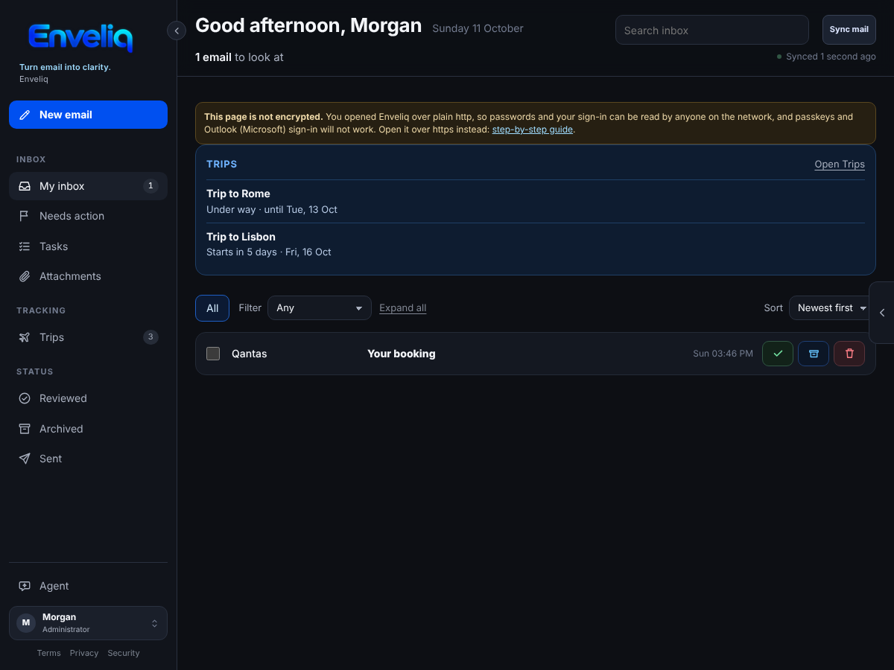
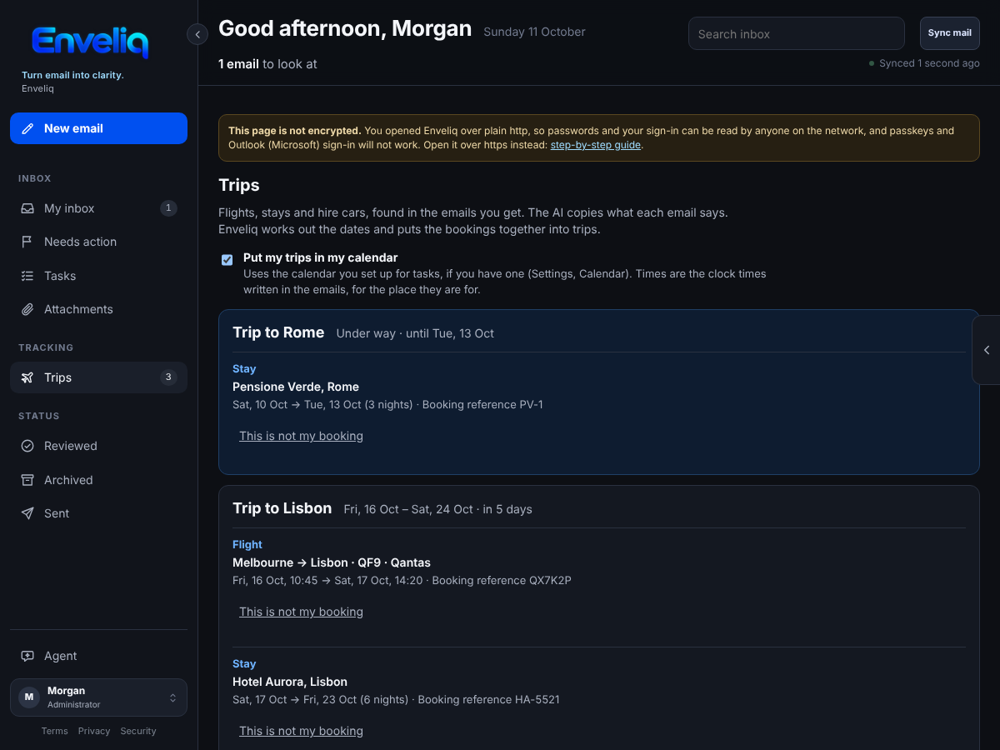
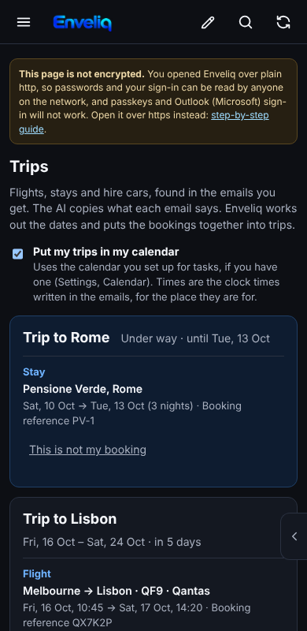

# Trips

Enveliq follows your flights, stays and hire cars from the booking emails you already get, puts them together into trips, and can add them to your calendar.

It is on for everyone. An administrator can switch it off for everyone, and you can switch it off for yourself, under **Settings, Features**.

## What you see

When an email is a booking, a change or a cancellation for a flight, a hotel or other stay, or a hire car, Enveliq files each part of it. A **Trips** entry appears in the left menu, under Tracking, as soon as there is at least one trip. When a trip is under way, or starts within a week, a small **Trips** card also appears on Home:

The Trips page lists each trip, with its bookings in date order:

Each booking shows what it is (**Flight**, **Stay** or **Hire car**), the places, the flight number or hotel name, the dates and times, the number of nights for a stay, and the booking reference. If an email says a booking was cancelled, it stays on the list, crossed out and marked **Cancelled**, for a week.

If something is not yours, press **This is not my booking**. It is removed, and Enveliq ignores emails about it from then on.

On a phone the cards stack:

## How trips are put together

The AI reads an email once and only copies what it says: the provider, the booking reference, the places, and the dates and times as the email wrote them. It is told not to work anything out. Enveliq does the rest in plain code:

- Bookings that are two days apart or less belong to the same trip. A flight home from the place an earlier flight went to joins that trip too, even when nothing else was booked in between, if it is within 45 days.
- The trip is named after its first booking: *Trip to Lisbon*.
- A change updates the booking it belongs to, and a changed date does not make a second one. An older email never overwrites a newer one.
- A time of day is used only when the email gives one.

A trip is forgotten three days after it ends. An email marked **Be careful** is never followed, so a fake booking change cannot put a trip on your Home page or in your calendar.

## In your calendar

If you have set up a calendar for your tasks (see [Calendar and to-do](CALENDAR.md)), your bookings go in it too, whether it is the calendar link, Google Calendar or CalDAV. The switch **Put my trips in my calendar**, at the top of the Trips page, turns that off and takes them out again. A flight with a departure time is a timed entry. The times are the clock times written in the email, for the place they are for, because Enveliq does not guess a time zone. A stay covers its nights and a hire car covers its days.

If you turn on **Keep titles private**, each entry says only *Enveliq trip*.

## What is kept

Only, for you alone, inside the encrypted vault: the kind, the provider, the booking reference, a flight number or hotel name, the places, the dates and times, and whether it was cancelled. No email text, no subject, no sender address and no links. Another person's trips are never visible to you, and administrators cannot read yours. Enveliq never contacts an airline, a hotel or a rental company.
